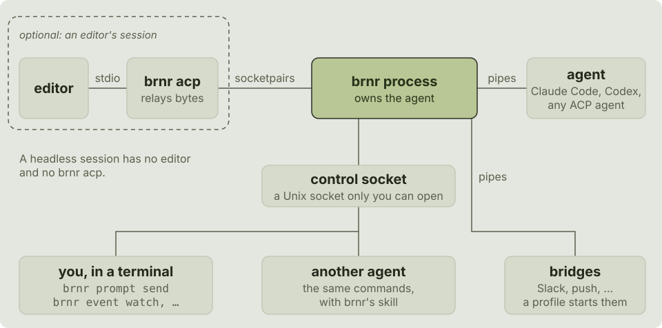

# brnr

**A burner phone for your coding agents.**

brnr keeps a coding agent reachable outside the editor that started it, and
lets its session carry on after the editor closes. You can watch, steer and
approve many agents from one terminal, from your phone, or from another
agent.

It works with any [ACP](https://agentclientprotocol.com/) agent: Claude Code
and Codex through their [adapters](guide/adapters.md), and others as they
are. `$s` below is a session's id, as `brnr session list` shows it.

## The session outlives the window

Your editor is one way in, not the only one. Close the editor and carry its
session on headless. You can also start sessions with no editor at all.

```sh
brnr acp -- brnr-claude-adapter  # your editor's agent command
brnr session resume $s           # after the editor closes: carry it on headless
brnr session new --cwd ~/work/project --prompt "fix the failing tests" -- brnr-claude-adapter
```

Watching an editor's session always works. Acting on it (sending, approving,
changing the mode) is experimental, enabled one action at a time in a
profile ([experimental actions](guide/editor.md#experimental-actions)).
[Use it from an editor](guide/editor.md) and
[headless sessions](guide/headless.md) have the rest.

## One place for many agents

`brnr session list` and `brnr permission requests` show every session and
every waiting approval, from editors and headless runs.

```sh
brnr session list                  # brnr's sessions: open ones and ended ones
brnr permission requests           # approvals waiting, in every session
brnr event watch $s                # live: messages, tools, plan, approvals
```

[Talk to it from outside](guide/outside.md),
[approvals](guide/approvals.md) and [events](guide/events.md) have the rest.

## Agents that drive agents

A CLI with `--json`, documented exit codes, events and a bundled skill.
Claude Code or Codex can use it to start workers, give them work, wait for
them, and answer their approvals.

```sh
brnr skill install                 # for Claude Code and Codex
brnr session new --json --stop-when-idle 600 --prompt - -- brnr-claude-adapter < task.md
brnr prompt send $s --wait --timeout 600 --json --prompt "what did you change?"
brnr permission allow $s p1 --json
```

Each situation has one exit code in every command; from 1.0.0 the codes,
`--json` and events are kept within a major version
([ADR 8.4](adr/0008-the-command-line-and-compatibility.md#84-what-the-compatibility-promise-covers)).
[For agents](guide/agents.md) has the rest.

## Reach it from anywhere

Bridges, programs you write or choose, forward events to Slack or push
notifications, and send your answers back. `brnr event notify` runs a
command for each event.

```toml
[profiles.work]                     # for sessions started with --profile work
agent = ["brnr-claude-adapter"]

[[profiles.work.bridges]]
command = "~/bin/slack-bridge"      # yours: events in, answers out
events = ["permission_request", "turn_ended"]
```

```sh
brnr event notify $s -- sh -c 'curl -s -d "$BRNR_TEXT" "https://ntfy.sh/${NTFY_TOPIC:?set it to a private topic}"'
```

`NTFY_TOPIC` is a topic only you know: anyone who knows an ntfy.sh topic can
read it.

[Events and notifications](guide/events.md) and
[bridges](guide/profiles.md#bridges) have the rest.

## How it works

<picture>
  <source media="(prefers-color-scheme: dark)" srcset="brand/diagram-dark.svg">
  
</picture>

- **brnr acp** is what the editor runs as its agent. It only relays bytes,
  between the editor's stdio and the brnr process.
- **The brnr process** owns the agent for its whole life, out of the
  editor's process group and process tree. When the editor goes, the agent
  goes, as if the editor had run it; `brnr session resume` carries a session
  on. A headless session has a brnr process and no `brnr acp`.
  `brnr process list` lists these processes.
- **The control socket** is each process's Unix socket, which only you can
  open. The other commands (`brnr prompt send`, `brnr event watch`, …) talk
  to a session through it, whoever runs them: you or another agent. Most
  are a group, what they act on, and a verb: `brnr <group> --help` lists a
  group's ([ADR 8.1](adr/0008-the-command-line-and-compatibility.md#81-commands-are-grouped-by-what-they-act-on-with-acps-verbs)).
  `--help` exits 0, and a command used wrongly exits 2 with its usage on
  stderr, having done nothing ([ADR 8.3](adr/0008-the-command-line-and-compatibility.md#83-waiting-and-exit-status)).
- **Bridges** a profile starts are the process's own children, on pipes:
  it sends them events on their stdin and reads their requests on their
  stdout. They speak the protocol the control socket speaks.

## How light it is

`brnr acp` relays bytes to a process that reads ACP once. What that adds,
on an Apple M4 Pro (14 cores, macOS 26.4) busy with other work, brnr 0.10.0
(81ae7d0), against a fake agent that answers at once:

| | Direct pipe | Through `brnr acp` |
|---|---:|---:|
| A prompt's round trip (median) | 10 µs | 68 µs |
| A turn that streams 20 MB | 784 MB/s | 157 MB/s |

At rest, `brnr acp` takes 2.7 MiB of memory and 3 threads, and its process
3.9 MiB and 12 threads; each connection to the process adds 2 threads, and
each bridge 4. A real agent takes far longer than this to answer, so what
brnr adds is a small part of a turn. Every pull request measures these
numbers against budgets ([N3](adr/0001-principles.md#n3-performance)).

## Scope

brnr is not an orchestrator, and decides nothing for you: it carries out
what you, or an agent you run, ask, and never picks an answer for you. It
runs as your user, and anything running as you can reach its socket and act
as you there ([threat model](threat-model.md)).

macOS and Linux (Unix sockets only). Why brnr does what it does, and what
else was considered, is in the [decision records](adr/README.md).

brnr never phones home: it makes no network requests of its own and sends
no telemetry ([P15](adr/0001-principles.md)).

## Where next

[Install](install.md) brnr and an adapter, then the guide: start with
[use it from an editor](guide/editor.md) or
[headless sessions](guide/headless.md). The
[interface reference](reference/overview.md) has the commands, JSON, exit codes,
configuration and the bridge protocol, for scripts and bridges.
